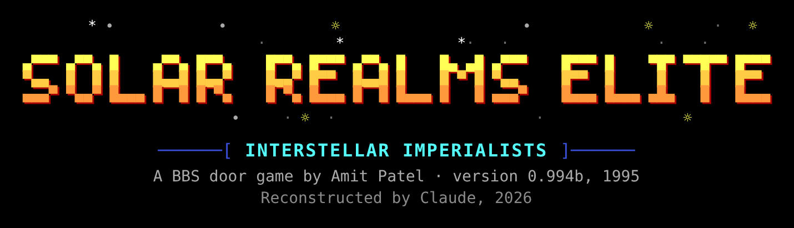
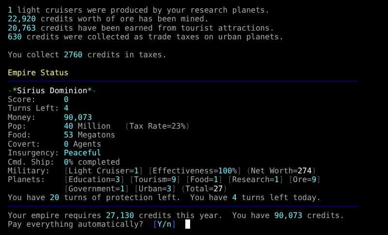

# Solar Realms Elite, reconstructed

Solar Realms Elite (SRE) is a BBS door game by Amit Patel.  Its source
code was lost in 1996.  This repository is a reconstruction of the last
release, **0.994b (March 7, 1995)**, in C++, made by reverse engineering
`SRE.EXE`.  It builds on a modern Mac (or Linux) and plays in a terminal.
It is published with Amit Patel's permission.

The aim is the original's exact behavior: the same screens, prompts,
colors and numbers, the same random events, and game files the original
can read.  That is checked by running the original under an emulator next
to the reconstruction with the same input and comparing everything (see
[Testing](#testing)).

## Quick start

    make
    tools/newgame.sh ~/sre "Your Name"
    cd ~/sre && /path/to/sre reset      # as the sysop: choose 2, Reset the Game
    /path/to/sre                        # play

## Building

On macOS, with the Xcode command line tools (`xcode-select --install`):

    make

This builds `./sre`.  Any C++11 compiler works (`make CXX=g++` on
Linux).

## Playing

The game needs the data files of the original release (help text,
screens, flavors, the research table); they are in `game/`.
`tools/newgame.sh` copies them into a directory to play in and writes a
door file for you:

    tools/newgame.sh ~/sre "Your Name"
    cd ~/sre
    /path/to/sre reset                  # once, as the sysop: set up the galaxy
    /path/to/sre                        # play

`sre reset` asks for the sysop's and the BBS's names and opens the sysop
menu; choose **2** (Reset the Game).  Afterwards `sre sysop` opens the
sysop menu again (empire viewer, player and pirate editors, messages).
Commands are not case sensitive.

Other players can share the directory: give each their own copy of
`DOORFILE.SR` (or edit its first and last lines, the user's name) and run
`sre` from the directory.  As on a BBS, one player at a time.

### The door file

`DOORFILE.SR` is what the BBS used to tell SRE about the caller, eight
lines:

    Your Name       the user's name on the BBS
    1               ANSI color (1/0)
    1               IBM (PC) characters (1/0)
    24              lines on the screen
    38400           baud rate
    1               COM port; 0 for a local (sysop) session
    60              minutes left
    Your Name       the user's real name

Settings from the original's `RESOURCE.DAT` and command line options
(`-Name=value`) work as described in the original's `DOCS/RESOURCE.DOC`.

### Environment

- `SRE_DIR`: the game directory (default: the current directory).
- `SRE_CHARSET`: `utf8` or `cp437`.  The game's text uses the IBM PC
  character set; on a UTF-8 terminal (the default on macOS) it is
  translated, unless this says `cp437`.
- `SRE_DATE_SHIFT`: years to move the clock back (default 28).  The
  original accepts dates from 1980 to November 1999 only; 28 years keeps
  the calendar the same and works until the end of 2027.  Set a larger
  multiple of 4 after that, and don't change it during a game.
- `SRE_CLOCK`: a fixed time (seconds since 1970) instead of the clock,
  for testing.
- `SRE_UNREGISTERED`: if set, registration works as in the original:
  unregistered without a valid `STATUS.SRE` (the tests use this to
  compare with the original).

## Playing on the web

`server/` is `sre-server`, which runs the game the way a BBS ran a door:
one shared game, one player at a time, each in a terminal in their
browser, on a page made to look like a BBS.  Players are known by keys
their browsers make (no passwords), and pick a name the first time.
Someone arriving while another plays waits for the line.  Closing the
tab hangs up, as a dropped modem connection did, and the game saves
and exits.  It needs Go to build:

    make sre server
    tools/newgame.sh /srv/sre/game
    server/sre-server -listen :8000 -game /srv/sre/game -sre ./sre \
        -keys /srv/sre/keys.json -sysops YourName

[`server/README.md`](server/README.md) has the details, and how to run
it on a small VM.

## What is reconstructed

All of the game: joining, turns, the economy, food, population, the
spending, selling and planet menus, operations, covert operations,
attacks of every kind, pirates, trading fleets, diplomacy, messages,
news, the lottery, the bank, bonds and investments,
events, research, maintenance, scores, the sysop menu and its editors,
resources, translations and flavors.  The source follows the original's
structure: one file per part of the program, with the original's
addresses (`segment:offset`) in the comments.

Left out, as parts of the BBS and DOS environment rather than the game:
the FOSSIL and serial port drivers, the sysop's status bars and hot keys
on the local screen, sysop chat, EMS/XMS swapping and the VGA palette.
The terminal stands in for both the caller's modem and, when nobody is
connected remotely (`sre sysop`, `sre reset`, local play), the sysop's
screen and keyboard.

The game is always registered: the bank, bonds, investments, the Super
Daily lottery and the full reset options are all there.  The registered
name and the bank's name come from `STATUS.SRE` if there is one (its key
is not checked); otherwise the game is registered to the sysop.

## Testing

`tests/smoke.sh` needs nothing but the build: it sets up a game from
`game/`, resets it, joins two players, plays turns and runs the next
day's maintenance, and compares the output and the game's data with
`tests/smoke/`, recorded from runs that are byte for byte the same as
the original's.  It is what CI runs.

    make && tests/smoke.sh

The full tests compare with the original itself.  `tools/dosemu.py` is a small DOS emulator (on
[Unicorn](https://www.unicorn-engine.org/)) that runs the original
`SRE.EXE` with scripted input on its serial line or keyboard and a
frozen clock.  The tests run the original and the reconstruction on
copies of the same game and compare the output byte for byte, the game
files, and the random number sequence.

    pip install unicorn pyte            # pyte only for tools/render.py
    tests/fixtures.sh /tmp/srefix       # games made by the original itself
    tests/run.sh /tmp/srefix            # the scenarios in tests/scenarios.txt
    tests/fuzz.sh /tmp/srefix army 1 20 # random play, seeds 1 to 20
    tests/fuzzchain.sh /tmp/srefix two 1 # two players taking turns over days

`tests/fixtures.sh` downloads the original release, `sre0994b.zip`, from
[John Dailey Software](https://www.johndaileysoftware.com/), checks it
against its SHA-256, and runs its `SRE.EXE` to make the games the
scenarios start from.  (Or give it the zip: `tests/fixtures.sh DIR
path/to/sre0994b.zip`.)

The original is unregistered without a registration file; with
`SRE_STATUS=path/to/STATUS.SRE`, `tests/fixtures.sh` also makes
registered games, for the scenarios of the bank, bonds and lottery.

`tools/difftest.sh` and `tools/localtest.sh` compare one run; the other
tools are the reverse engineering kit (de-overlaying the executable,
disassembly, a pseudo-C lifter, data file decoding and editing).
`tools/re/` has the original's functions (address, size, callers and
callees, from Ghidra) and the names `tools/disasm.py` and `tools/lift.py`
give them (`names.txt`; `globals.txt` is for data addresses).

## The Rust port

The `rust` branch has the same game ported to Rust, module for module
from the C++.  It is held to the same standard: its output and files
are byte for byte the same as the C++ build's (and so the original's)
in all of the scenarios and in thousands of random games.  It builds
with Cargo (`make` runs `cargo build --release` and copies the binary
to `./sre`), and it has no dependencies beyond `libc`.

## How it was made

The reconstruction was done by Claude, in Claude Code, directed by Joe
Shaw.  It began with this prompt, in an empty repository:

> solar realms elite was a bbs door from the 90s. the source code was lost
> in 1996.
>
> i want you to reverse engineer the last release (available at
> https://www.johndaileysoftware.com/download/?method=2&terms=1) from the
> binary and produce source code we can compile on a modern mac. it is not
> necessary to reconstruct the BBS/fossil parts, but the gameplay and text
> user interface need to be reconstructed perfectly from the original.
>
> Additional info from the original author can be found on
> http://www-cs-students.stanford.edu/~amitp/Articles/SRE-Design.html and
> other pages on his site.
>
> Use this repository to build it

(That download link no longer serves the zip; `tests/fixtures.sh` has
one that does.)

The approach:

1. **Taking the binary apart.**  `SRE.EXE` is a Borland C++ 3.1
   large-model program whose code is mostly in VROOMM overlays.
   `tools/deoverlay.py` turns it into a plain executable with every
   segment in place, so that it can be disassembled as a whole: Ghidra
   (headless) for the function list and call graph (`tools/re/`),
   `tools/disasm.py` (on [Capstone](https://www.capstone-engine.org/))
   for listings annotated with names, strings and the virtual tables
   `tools/vtables.py` finds, and `tools/lift.py`, a pseudo-C lifter for
   Borland's code, for reading them.  `tools/re/names.txt` names about
   120 of the original's functions, the ones identified first (the
   Borland runtime, streams, files, resources and strings), so that the
   listings show calls to them by name rather than by address.
2. **Running the original.**  `tools/dosemu.py` is just enough of DOS,
   the BIOS and a FOSSIL driver, on
   [Unicorn](https://www.unicorn-engine.org/), to run `SRE.EXE` with
   scripted input on its serial line or keyboard, a frozen clock, and its
   output, screen and files captured.  This made the original the
   specification: any question about its behavior could be answered by
   running it.
3. **Writing the source.**  The game was reconstructed one part of the
   original at a time, in C++ with the original's structure: one file
   per code segment, the original's classes (streams, menus, the
   streamable objects in the data files), and each function's address in
   a comment.  The Borland runtime's behavior that the game depends on
   is reproduced exactly: its random number generator, its date and time
   conversions, its `ctype` table and text-mode file reads, and 16-bit
   integer arithmetic throughout.
4. **Checking it.**  Every part was compared with the original, byte for
   byte, by running both on copies of the same game with the same input:
   the output, the game's files (decrypted), and the random number
   sequence (through the encryption salts it produces).  The scenarios
   in `tests/scenarios.txt` go through the menus and features; random play
   (`tests/fuzz.sh`, and `tests/fuzzchain.sh` for several players over
   several days) found what they missed.  Thousands of random games play
   out identically.
5. **Naming.**  Names first came from the disassembly (fields named by
   their offsets in the records, such as `d188`); once everything worked,
   each was renamed from how the game uses it (`pollution`), with the
   tests confirming nothing changed.

## Credits

Solar Realms Elite was written by Amit Patel.  His notes on its design
are at <http://www-cs-students.stanford.edu/~amitp/Articles/SRE-Design.html>.
The game is distributed by John Dailey Software.
